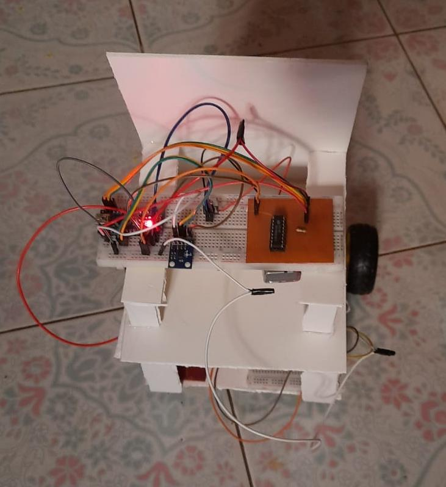
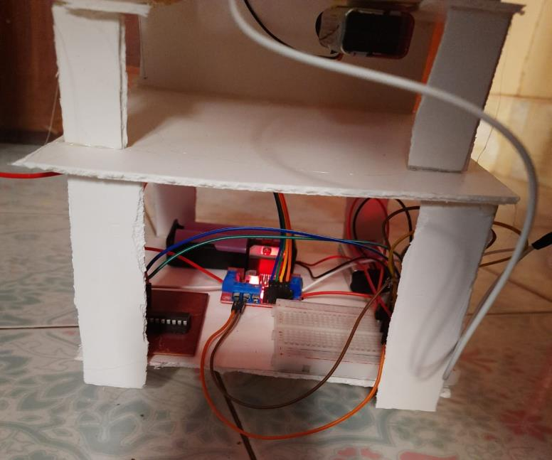
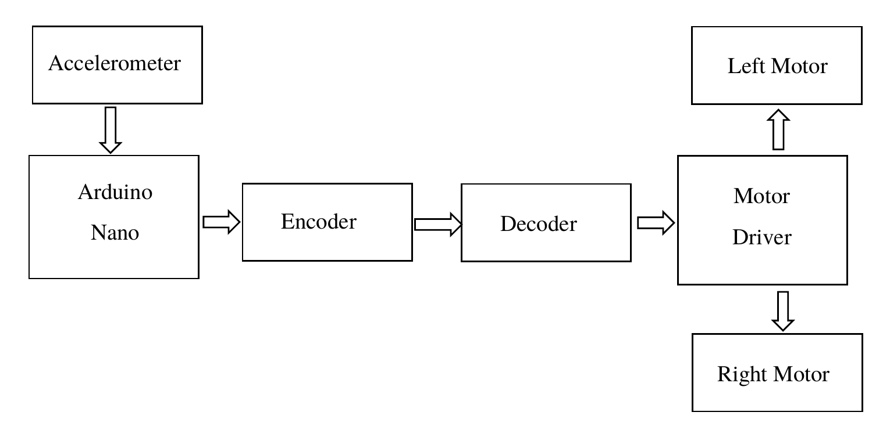
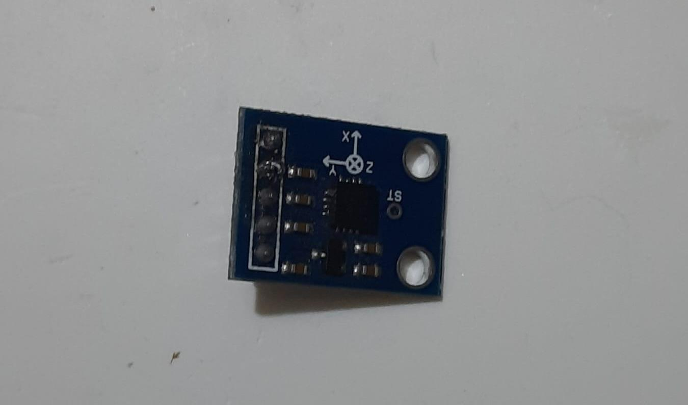
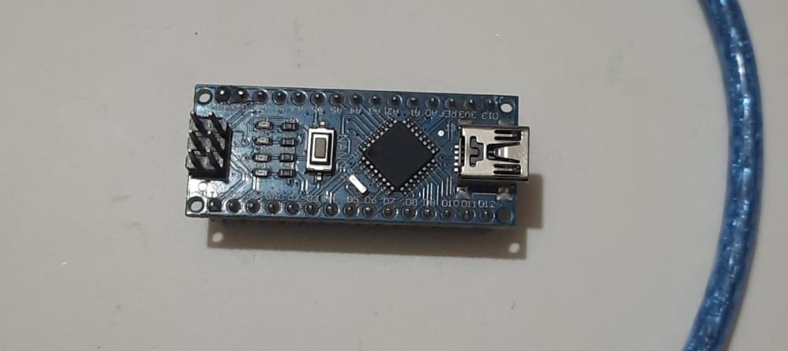
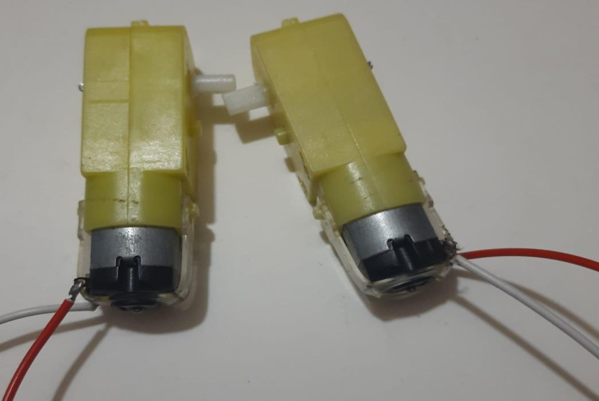
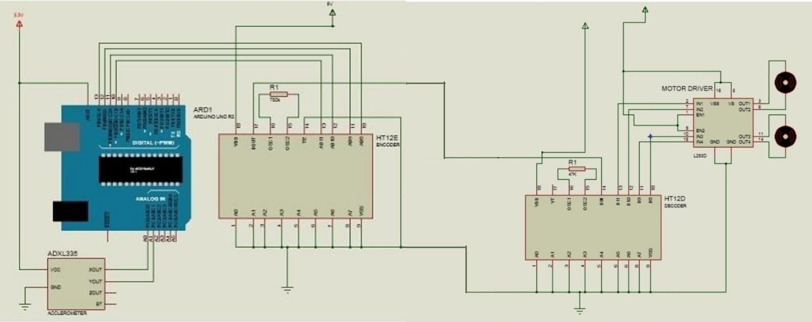
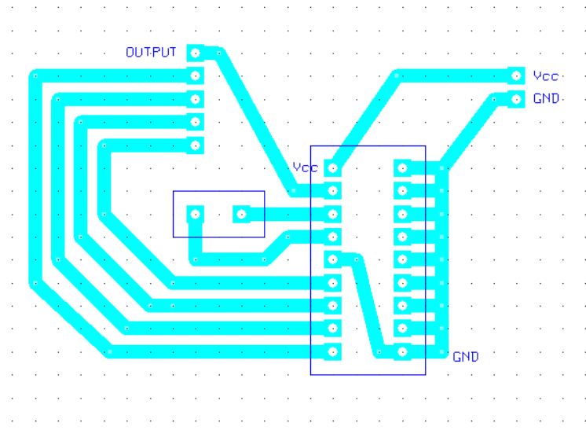
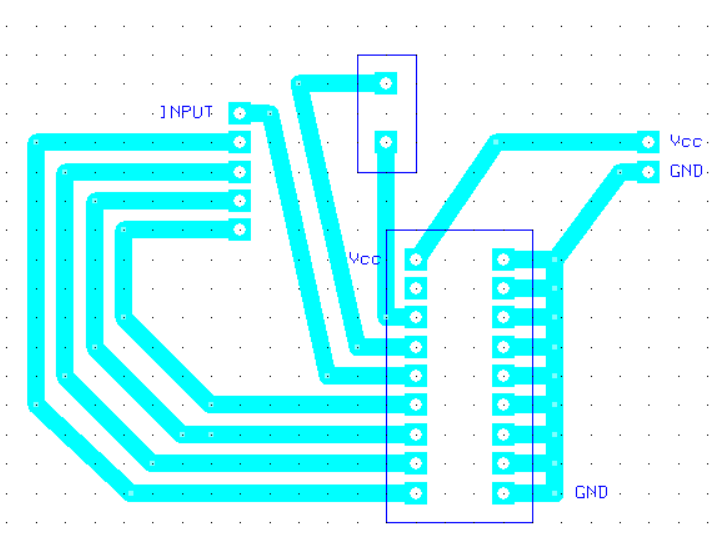

# ♿ Arduino-Based Hand Gesture Controlled Wheelchair

<p align="center">
  
  
  
  
  
  
  
</p>

<p align="center">
  <b>A low-cost gesture-controlled wheelchair prototype: a hand-worn accelerometer sets the direction, an encoder/decoder link carries the command, and an H-bridge drives the motors.</b>
</p>

<p align="center">
  
  
</p>

---

## 📌 Overview

Many wheelchair users depend on another person or must turn the wheels by hand. This project replaces that with hand tilt. An **ADXL335** three-axis analog accelerometer worn on the hand is read by an **Arduino Nano**, which turns the tilt into one of five motion commands. The command goes through an **HT12E encoder → HT12D decoder** pair to an **L298N** motor driver that drives the left and right DC motors.

Built as the course project for **ETE 2200: Electronic Project Design & Development**, Department of Electronics & Telecommunication Engineering, Rajshahi University of Engineering & Technology (RUET).

## ✨ Features

- **Five motion states:** forward, backward, left, right, and stop.
- **Tilt-based control:** natural hand movements, no buttons or joystick.
- **Dead band:** small, unintended hand movements keep the chair stopped.
- **Tunable thresholds:** adjust the trigger values per user (see [Tuning](#-tuning-the-gestures)).
- **Live debug output:** raw X/Y readings and the current command are printed on the Serial Monitor at 9600 baud.
- **Address-matched link:** the decoder only accepts frames whose 8 address bits match the encoder's.
- **Custom PCBs:** separate encoder-side and decoder-side boards, designed in ExpressPCB.
- **Low cost:** built from widely available parts.

## 🧠 System architecture

<p align="center">
  
</p>

```text
 Hand gesture ─► ADXL335 ─► Arduino Nano ─► HT12E ─(wire)─► HT12D ─► L298N ─► Left / Right motors
                 (X, Y)     threshold        12-bit         address    H-bridge
                            logic            serial frame   check
```

1. The ADXL335 outputs analog X and Y voltages, read on `A3` and `A2` by the Nano's 10-bit ADC (0–1023).
2. The Nano compares the readings against thresholds and sets four output pins (`D10`–`D13`) to a command pattern.
3. Those pins feed the four data inputs (AD0–AD3) of the **HT12E**, which sends them as a 12-bit serial frame (8 address bits + 4 data bits).
4. The **HT12D** checks the address bits and latches the four data bits on its output pins.
5. The decoder outputs drive the **L298N** inputs, which set each motor's direction.

### Gesture → command table

These values come from the firmware in [`src/`](src/gesture_wheelchair/gesture_wheelchair.ino).

| Gesture (ADC reading) | Command | Q1 | Q2 | Q3 | Q4 | Motion |
|---|---|:-:|:-:|:-:|:-:|---|
| X < 320 | Left | 1 | 0 | 1 | 0 | One motor reversed, pivots left |
| X > 370 | Right | 0 | 1 | 0 | 1 | One motor reversed, pivots right |
| Y > 400 | Forward | 1 | 0 | 0 | 1 | Both motors forward |
| Y < 310 | Backward | 0 | 1 | 1 | 0 | Both motors reverse |
| otherwise | Stop | 0 | 0 | 0 | 0 | Motors off |

The checks run in that order, so left and right take priority over forward and backward.

## 🔬 Results

A working prototype was built on a foam-board chassis (photos above): the transmitter electronics are on top, and the L298N, decoder PCB and battery pack are underneath. The motion logic in the table above is the behaviour implemented in the firmware.

| Item | Result |
|---|---|
| Motion states implemented | 5 (forward, backward, left, right, stop) |
| Control inputs | 2 axes of one ADXL335 (X and Y) |
| Command link | HT12E → HT12D, 12-bit frames, 8 address bits + 4 data bits |
| Motor supply | 7.4 V (two 3.7 V Li-ion cells in series) |
| Controller supply | 9 V battery to the Arduino Nano |
| Motor speed (rated) | up to about 200 rpm per DC motor |
| PCBs designed | 2 (encoder side, decoder side) |

The project report documents the prototype but records no quantitative measurements, such as response time, range, or load tests, so none are claimed here.

### Known limitations (from the report)

- **Wired link:** the encoder and decoder are connected by a wire, which limits operating range.
- **Single point of failure:** a power-supply failure shuts the system down, and a damaged component can cause unsafe behaviour.
- **No speed control:** the drive uses simple on/off direction states.

## 🔌 Hardware

| Component | Role |
|---|---|
| ADXL335 3-axis analog accelerometer (±3 g) | Hand tilt sensing |
| Arduino Nano (ATmega328P) | Reads the sensor and picks the command |
| HT12E encoder IC | Parallel → serial frame |
| HT12D decoder IC | Serial frame → parallel outputs |
| L298N dual H-bridge motor driver | Drives the two motors |
| Battery-operated DC gear motors, wheels, castor wheel | Drive train |
| 9 V battery + 2 × 3.7 V Li-ion cells, voltage regulator IC | Power |
| PVC / foam board, connecting wires | Chassis |

<p align="center">
  
  
  
  
</p>

## 🧩 Circuit and PCB design

<p align="center">
  
</p>

The schematic is the Proteus simulation model. It shows an Arduino Uno and an L293D driver as stand-ins; the built prototype uses an **Arduino Nano** and an **L298N** module.

<p align="center">
  
  
</p>
<p align="center"><i>Encoder-side PCB (left) and decoder-side PCB (right), designed in ExpressPCB.</i></p>

## 🚀 Getting started

1. Wire the hardware as in the schematic. The ADXL335 X and Y outputs go to `A3` and `A2`, and the Nano's `D10`–`D13` go to the HT12E data inputs (AD0–AD3). The HT12E and HT12D address pins must be set to the same pattern.
2. Open [`src/gesture_wheelchair/gesture_wheelchair.ino`](src/gesture_wheelchair/gesture_wheelchair.ino) in the **Arduino IDE**.
3. Select **Arduino Nano** and the right processor, then upload.
4. Open the **Serial Monitor** at 9600 baud. You'll see the raw X/Y readings and the current command.

## 🎚 Tuning the gestures

Hold your hand level and read the X/Y values in the Serial Monitor, then adjust the four thresholds in `loop()` so that the level reading falls inside the dead band:

```cpp
if      (x < 320) left();
else if (x > 370) right();
else if (y > 400) forward();
else if (y < 310) backward();
else              stop_();
```

> **Note:** the report's *Working Principle* section lists different threshold values (X > 390 forward, X < 310 backward, Y < 320 left, Y > 380 right). This repo keeps the values in the report's *Arduino Code* appendix. Use the Serial Monitor to calibrate for your own sensor, since ADXL335 offsets vary between boards.

## 🔭 Future work

From the project report:

- Better motors and wheels for finer control of movement.
- A second accelerometer on the chassis to detect falls or accidents.
- A health-monitoring module that alerts a professional when the user's condition changes.
- A second Arduino on the chassis to control the motor driver and add speed control.

A natural next step is replacing the wired link with an RF link, since the HT12E/HT12D pair is designed for RF and IR remote control.

## 📁 Repository structure

```text
.
├── README.md
├── LICENSE
├── src/
│   └── gesture_wheelchair/
│       └── gesture_wheelchair.ino     # Arduino Nano firmware
├── assets/
│   ├── diagrams/                      # block diagram, schematic, PCB layouts
│   └── images/                        # prototype and component photos
└── docs/
    └── project_report.pdf             # full ETE 2200 project report
```

## 📚 Report

The full report, with component descriptions, working principle, and the original code, is in [`docs/project_report.pdf`](docs/project_report.pdf).

## 👤 Author

**Saeedul Haque**, Dept. of Electronics & Telecommunication Engineering, RUET.
Supervised by Farzana Akter, Lecturer, Dept. of Electronics & Telecommunication Engineering, RUET.

## 📄 License

This project is licensed under the [MIT License](LICENSE).
